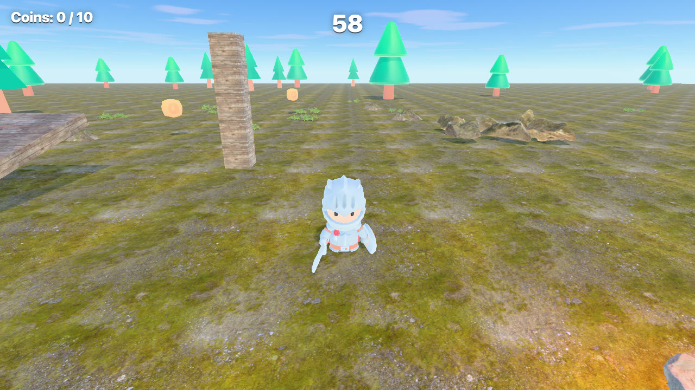

# AI Game Jam Starter (3D, three.js)

> **AI agents: start here.** If someone opened this folder with you, or asked you to download or set up this
> project, they are a team of kids at a game design workshop (or the mentor sitting next to them), not
> developers. Don't answer with setup steps, commands or a summary of this README. Do this instead:
>
> 1. Read [`AGENTS.md`](AGENTS.md) now: it is the rule book for everything you say and build here.
> 2. In the project folder, run `npm run status` yourself (and again at the start of every message). It installs
>    everything, starts the game, opens it in the browser and makes a public link to it. The kids never type
>    commands. (No Node.js on the computer? `sh scripts/bootstrap.sh`, or on Windows
>    `powershell -ExecutionPolicy Bypass -File scripts\bootstrap.ps1`. PowerShell blocks `npm`? Write `npm.cmd`.)
> 3. Then your first words to the team are one friendly sentence and the opening question: **what's your idea?**
>    (in their own words or a whiteboard photo; 3 fresh ideas if they have none). From there you
>    design it together in stages: World → Player → Goal → Mechanics → Details, a few rounds each.
>
> Only someone who says they are a mentor or maintainer changing the starter itself gets a developer-style answer.

A starter project for a 4-hour game jam where pairs of kids (12+) with no coding experience build a real 3D
game by talking to an AI coding agent ([Codex](https://developers.openai.com/codex)). The boring and hard parts are already
done, so the kids spend their time on ideas, design and tuning.

The game starts with an empty world the kids can already walk around in. The AI sets
the project up by itself, asks the team for their idea (their own words, or a photo of their whiteboard), then
runs a design workshop in five stages
(**World**, **Player** + view, **Goal**, **Mechanics**, **Details**). Each stage takes a few rounds: the AI
builds a playable draft, the kids play it, and it offers a few fresh directions for the next step. The team's
plan lives in [`our-game.md`](our-game.md). Every reply ends with the game's **public link**, so friends can
play it on their phones while it is being made (see [Sharing](#sharing-the-public-link)). It shows pictures
before building (the kids' own sketches or gpt-image-2.6) and downloads models on demand from Kenney, KayKit, Quaternius, Poly Pizza,
Poly Haven, the Smithsonian and Objaverse (800,000 models).



Out of the box:

- A realistic-looking 3D world: animated sky with clouds and time of day, sun shadows, fog, glow, photo skies.
- A third-person player that walks, runs, jumps, climbs steps and pushes things, with automatic animations.
- Physics (Rapier): things fall, stack, bounce and get knocked over. Colliders fit each model (exact for scenery),
  a collider view (`npm run snap -- --colliders`) shows them with a "forward" arrow on characters and cars, and
  physics checks warn about things that start inside each other, fall through the floor or face sideways.
- Characters with real collisions for enemies and NPCs, and an arcade car.
- Sliders for every number (press `` ` `` in the game). Slider values save to `src/tuning.json` automatically.
- Title / win / lose screens, HUD text and health bars, made-up sound effects, particles, screen shake.
- 140+ free (CC0) models: 6 animated characters (mage, rogue, barbarian, two skeletons, robot),
  vehicles and race track pieces, dungeon, graveyard, space base, city, rocks, realistic props (no knight and no
  trees on purpose: the AI shows the kids pictures of real choices from the libraries instead);
  4 photo skies, 12 realistic textures, 19 sounds. See [`public/assets/CATALOG.md`](public/assets/CATALOG.md).
- AI rules ([`AGENTS.md`](AGENTS.md), which Codex reads by itself) that keep
  the AI short, kid-friendly, safe and cheap, plus skills (plain Markdown in [`.agents/skills/`](.agents/skills))
  with tested recipes for game features, model downloads and model remixing.
- Tools for the AI: `npm run snap` lets it *see* the game (headless screenshot + errors), browser errors
  are copied to `logs/browser.log`, and `npm run check` catches broken code in under a second.
- Save points for kids who never used git: `npm run save`, `npm run saves`, `npm run undo`, `npm run load`.
- A public link to the game while it is being made (a Cloudflare Quick Tunnel, no account): every change shows
  up there by itself, on any phone or computer.

Mentors: read [`MENTORS.md`](MENTORS.md). Print [`docs/PROMPT-CARD.md`](docs/PROMPT-CARD.md) for each team.

## Quick start

You need [Codex](https://developers.openai.com/codex) running on the computer itself, a browser (Chrome or
Edge) and the internet. [Node.js 22 or newer](https://nodejs.org) and [Git](https://git-scm.com) are best
installed beforehand. If they are missing, the setup gets its own copies into the project folder (`.tools/`):
Node.js on every system, Git on Windows.

**1. Download the project first** into its own folder:

```bash
git clone <this repo> my-game
```

(or "Download ZIP" on GitHub and unpack it).

**2. Open that folder with Codex.** Codex must be started in the game folder itself: that is where it finds its
rules, skills and helpers. In a terminal: `cd my-game`, then `codex`. In the Codex app or an editor: open the
`my-game` folder as the project. Trust the folder when Codex asks: `.codex/config.toml` then lets its commands
use the internet (the public link, model downloads and picture previews need it). Without trust, start it with
`codex --config sandbox_workspace_write.network_access=true`.

**3. Say hi:** *"Hi! We're ready to make our game."* The AI installs what's missing, opens the game in the
browser, gives you its public link and asks for your idea. Nobody has to type commands.

**Windows:** to prepare a laptop before Codex is involved, double-click `setup.cmd` in the folder (it gets
Node.js and Git if they are missing, installs the engine, starts the game and prints its link). In PowerShell,
`npm` is often blocked ("running scripts is disabled"): write `npm.cmd` instead, for example `npm.cmd run status`.
Inside WSL, use the Mac and Linux commands; the game still opens in the Windows browser.

An agent that runs its commands in a cloud or sandbox machine (not on this computer) can write the game but
cannot open it on your screen (you would play through the public link only).

Optional: copy `.env.example` to `.env` and add an `OPENAI_API_KEY` for picture previews (gpt-image-2.6).

## Sharing: the public link

`npm run setup` starts a [Cloudflare Quick Tunnel](https://developers.cloudflare.com/cloudflare-one/connections/connect-networks/do-more-with-tunnels/trycloudflare/)
from the internet to the game running on this computer and prints a link like
`https://four-random-words.trycloudflare.com`. Anyone with the link can play, on a phone too (touch controls are
built in). It shows the live game: when the AI changes something, every open page updates by itself. No account,
no build, no upload.

- **The AI only shows a link it just checked** by fetching the game through the internet (`npm run save` and
  `npm run share` do that every time, and start the tunnel again if it stopped).
- **The link lives while this computer is on, online, and the game is running.** It stays the same for as long
  as the tunnel keeps running; after a restart, sleep or lost Wi-Fi the AI gives a new link and says so (a host
  who keeps a list of the games updates it by hand). While the game runs, the setup keeps the computer from
  falling asleep by itself (not past a closed lid; `KEEP_AWAKE=off` in `.env` switches that off). Quick Tunnels are a
  free testing service without guarantees, and one carries up to 200 requests at once: fine for a few friends,
  not for a whole room opening it in the same second. For a link that stays after the jam, upload `npm run build` (see
  Commands).
- **Visitors only get the game.** They can't save sliders, write logs or read the project's private files
  (`.env`, `.git`, logs); the game's own code is visible, like on any web page.
- **Switch it off** on a computer with `PUBLIC_LINK=off` in `.env` (see `.env.example`).
- The first time, the tunnel program (`cloudflared`, about 40 MB) is downloaded from Cloudflare's GitHub releases
  into `.tools/`.

## Controls

| Key | Does |
|---|---|
| W A S D or arrows | move |
| Shift | run |
| Space | jump |
| Mouse | look around (click the game to lock the mouse, Esc to unlock) |
| `` ` `` (backquote) | show or hide the sliders |

## Commands

| Command | What it does |
|---|---|
| `npm run status` | the AI's first command for every message: sets up or repairs whatever is missing, then prints the checked public link, where the team is and a few idea sparks |
| `npm run setup` | install what's missing, start the game in the background, open it in the browser and make its public link (`-- --stop` stops the game and the link) |
| `npm run share` | print only the game's public link, checked through the internet (repairs it if it stopped) |
| `npm run dev` | start the game in this terminal instead (keep it running; it reloads by itself) |
| `npm run save -- "what works now"` | make a save point (and print the checked public link) |
| `npm run saves` | list save points |
| `npm run undo` | throw away changes since the last save point (they're kept in a backup) |
| `npm run load -- 3` | go back to save point #3 |
| `npm run check` | quick check that the code loads |
| `npm run snap` | screenshot of the game + any errors (the AI uses this to see) |
| `npm run inspect -- <file.glb>` | size, parts, bones and animation names of a model |
| `npm run assets -- ...` | search and download free models (Kenney, KayKit, Quaternius, Poly Pizza, Poly Haven, Smithsonian, Objaverse); see the skills |
| `npm run remix -- ...` | change a model file: color, parts, size, animations |
| `npm run preview -- "..."` | show a picture on the game screen (a sketch photo, or one drawn by the image AI) |
| `npm run spark` | a few random idea ingredients for the stage the team is in (the AI mixes them into its suggestions) |
| `npm run build` | make a `dist/` folder you can upload anywhere (itch.io, Netlify, GitHub Pages) |

## Commands for the kids (typed into Codex)

- `$idea` plan the next stage or a big feature together (the AI asks questions first)
- `$explain` explain the last change like you're 12, plus a Code Detective challenge
- `$bug` fix something that's broken

## Project layout

```
our-game.md        the team's theme, stages and rounds (the AI keeps it updated)
src/game/          the kids' game (starts as an empty world)
src/tuning.json    slider values (saved automatically)
src/engine/        the engine (world, physics, player, cars, UI, sound, effects)
public/assets/     models, skies, textures, sounds + CATALOG.md and CREDITS.md
.agents/skills/    guides the AI reads (Codex finds repo skills here)
.codex/            Codex settings for this folder (commands may use the internet)
scripts/           status, setup and public link, check, snap, save points, model inspector, asset downloader,
                   remix, preview, sparks
setup.cmd          Windows: double-click to prepare a laptop
.tools/            programs the setup downloaded for this computer (cloudflared; Node.js and Git if missing)
```

## Credits and license

Code: MIT (see [`LICENSE`](LICENSE)). Assets: CC0 (public domain) from KayKit (Kay Lousberg), Kenney,
Quaternius and Poly Haven; full list in [`public/assets/CREDITS.md`](public/assets/CREDITS.md).
Built with [three.js](https://threejs.org), [Rapier](https://rapier.rs), [lil-gui](https://lil-gui.georgealways.com) and [Vite](https://vite.dev).
